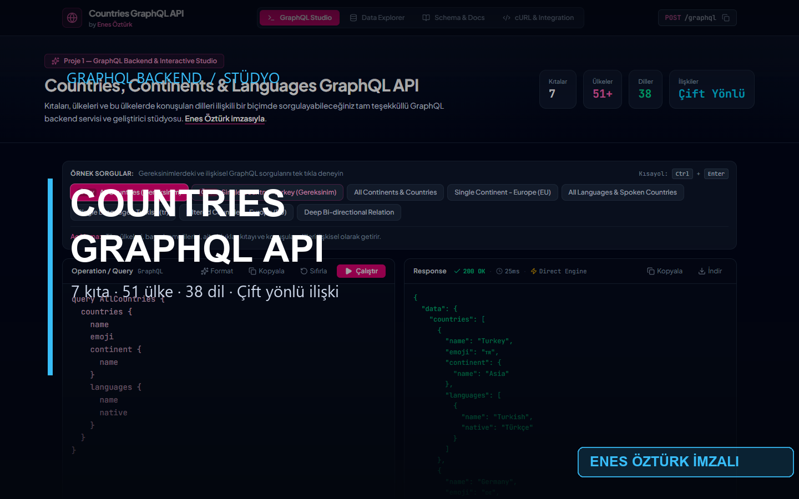
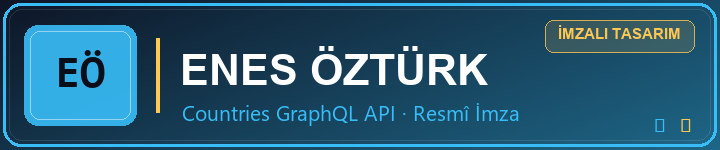
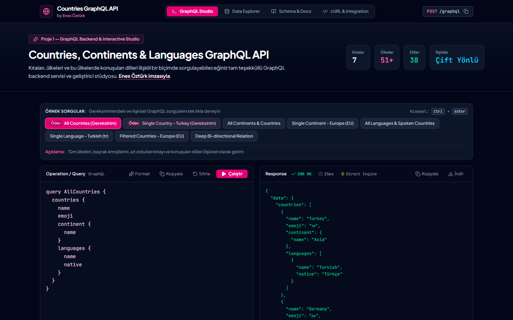
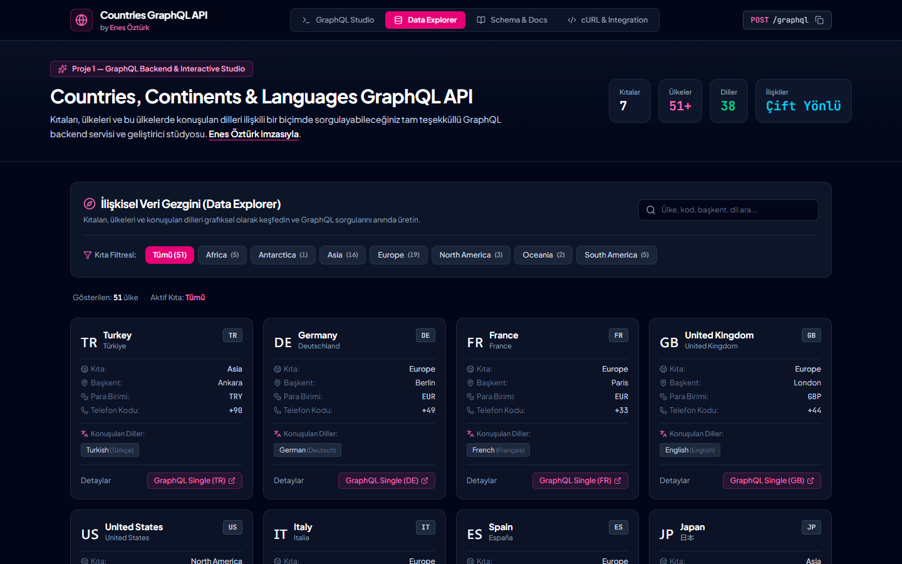
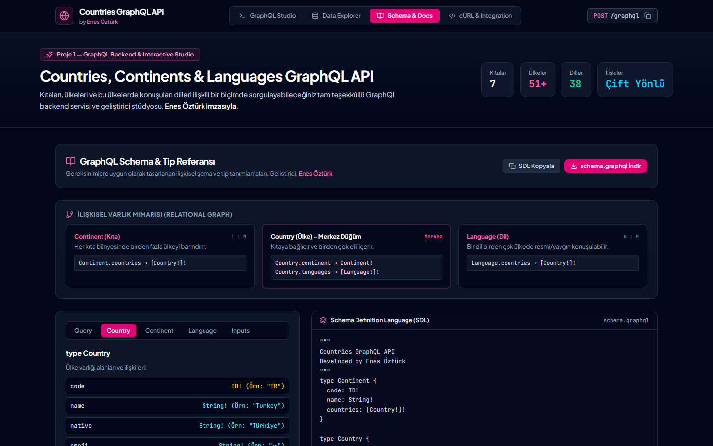

<div align="center">



# Countries GraphQL API

**7 kıta, 51 ülke ve 38 dili ilişkili biçimde sorgulayabilen tam teşekküllü GraphQL backend ve geliştirici stüdyosu.**

[](https://github.com/EnesBinMalik/countries-graphql-api)
[](https://github.com/EnesBinMalik/countries-graphql-api)
[](https://github.com/EnesBinMalik/countries-graphql-api)
[](https://github.com/EnesBinMalik/countries-graphql-api)
[](https://github.com/EnesBinMalik/countries-graphql-api)
[](https://github.com/EnesBinMalik)



</div>

---

## Hakkında

Countries GraphQL API; kıtalar, ülkeler ve diller arasındaki çift yönlü ilişkileri tarayıcı üzerinden keşfetmenizi sağlar. Express tabanlı `/graphql` uç noktası, elle yazılmış şema ve çözümleyicilerle çalışır; arayüzdeki stüdyo gerçek sorguları çalıştırır, sonuçları biçimlendirir ve cURL olarak dışa aktarır.

> Bu proje **Enes Öztürk** tarafından tasarlanmış, geliştirilmiş ve imzalanmıştır.

---

## Öne çıkan özellikler

| Özellik | Açıklama |
| --- | --- |
| **GraphQL Studio** | Sorgu editörü, değişken paneli, `Ctrl + Enter` ile çalıştırma. |
| **8 örnek sorgu** | Tek tıkla çalışan gereksinim ve ilişkisel sorgu şablonları. |
| **Data Explorer** | Kıta → ülke → dil ilişkilerini görsel olarak gezinme. |
| **Schema & Docs** | Tipler, alanlar ve açıklamalarla şema dökümü. |
| **cURL & Integration** | Sorguyu doğrudan cURL komutuna dönüştürme. |
| **Format / Kopyala / İndir** | Sorgu düzenleme ve dışa aktarma araçları. |

---

## Veri seti

| Ölçü | Değer |
| --- | --- |
| Kıta | 7 |
| Ülke | 51+ |
| Dil | 38 |
| İlişki | Çift yönlü |

---

## Galeri







---

## Kurulum

**Gereksinim:** Node.js 20+

```bash
git clone https://github.com/EnesBinMalik/countries-graphql-api.git
cd countries-graphql-api
npm install
npm run start
```

> Hem tarayıcı içi stüdyo hem de Express sunucusu aynı çözümleyiciyi kullanır.

Diğer komutlar:

```bash
npm run build     # Üretim derlemesi
npm run preview   # Derlemeyi önizle
npm run lint      # TypeScript tip kontrolü
```

---

## Teknik mimari

```text
src/graphql/data.ts       Kıta, ülke ve dil veri kümesi
src/graphql/executor.ts   Sorgu çözümleyici ve doğrulama
src/graphql/samples.ts    Hazır örnek sorgular
src/components/           Studio, Explorer, Schema, Docs
server.ts                 Express /graphql uç noktası
```

---

## İmza

<div align="center">

[](https://github.com/EnesBinMalik)
[](https://github.com/EnesBinMalik)

**Bu kod, tasarım ve deneyim Enes Öztürk'ün kişisel imzasını taşır.**

© 2026 Enes Öztürk — Tüm hakları saklıdır.

</div>
